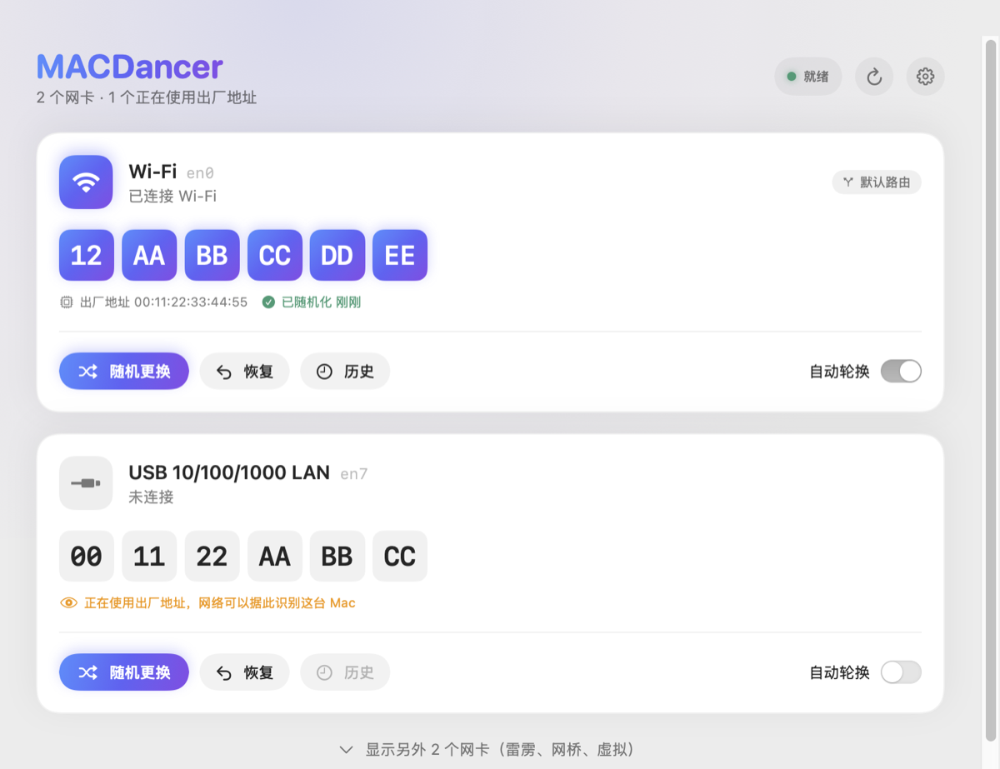
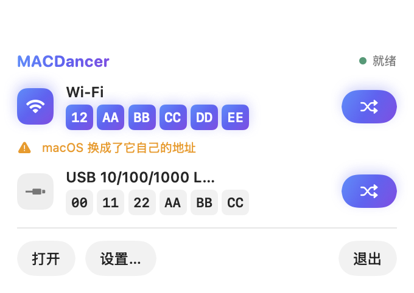

<p align="center">
  
</p>

<h1 align="center">MACDancer</h1>

<p align="center">一键更换 Mac 的 Wi-Fi 与以太网 MAC 地址，让网络更难追踪你。<br>macOS 14 及以上 · 中文 / English · 约 2.6 MB</p>

<p align="center">
  <a href="https://github.com/Jaaayden/MACDancer/releases/latest"><b>下载最新版本</b></a>
</p>

<p align="center">
  
</p>

## 功能

- **一键随机更换**：生成安全的随机地址（本地管理的单播地址），写入后读回确认才算成功。
- **Wi-Fi 也能改**：已连接的 Wi-Fi 会在你确认后断开、换好地址，再由你在 Wi-Fi 菜单里点一下重新连接。
- **随时恢复**：恢复出厂地址、使用以前用过的地址，或手动输入一个地址。
- **自动轮换**：可在唤醒后、网卡断开后或睡眠前自动换新地址，**绝不打断正在使用的连接**。
- **菜单栏面板**：不用打开窗口，直接在菜单栏查看和更换地址。
- **应用内更新**：发现新版本后一键安装，安装前校验签名。
- **干净卸载**：设置里一键卸载，不留残余文件。

## 安装

1. 从 [Releases](https://github.com/Jaaayden/MACDancer/releases/latest) 下载 `MACDancer-x.y.z.zip`，解压后把 **MACDancer** 拖进“应用程序”文件夹。
2. 打开 MACDancer，点 **设置助手**。
3. 按提示在 **系统设置 › 通用 › 登录项与扩展** 中允许 MACDancer。完成后窗口会自动变为“就绪”。

只查看地址不需要第 2、3 步；修改地址需要这个带管理员权限的后台助手，只需批准一次。

## 使用

| 操作 | 说明 |
| --- | --- |
| **随机更换** | 给网卡换一个新的随机地址。正在使用的网卡会先请你确认。 |
| **恢复** | 恢复出厂地址、输入指定地址，或让 MACDancer 不再管理这个网卡。 |
| **历史** | 查看、复用或删除以前用过的地址（每个网卡最多 20 条）。 |
| **自动轮换** | 打开后，按“设置 › 轮换”中选择的时机自动换地址。 |
| 点击地址 | 拷贝当前地址。 |
| `⌘R` / `⌘,` | 重新读取地址 / 打开设置。 |

菜单栏面板：



## 更新与卸载

**更新**：MACDancer 每天检查一次新版本（可在设置中关闭）。有更新时窗口右上角会出现“更新到 x.y.z”，点一下即可安装并自动重启，后台助手也会随之更新。

**卸载**：打开 **设置 › 助手 › 卸载 MACDancer**。它会移除后台助手和它保存的设置与历史、删除本 App 的偏好设置和缓存，并把 App 移到废纸篓。已修改的地址会保留到下次重启，之后 macOS 会恢复使用硬件地址。

> 如果直接把 App 拖进废纸篓，后台助手的登录项和 `/Library/Application Support/local.macdancer.MACDancer` 会留下来。请尽量用上面的卸载按钮。

## 注意事项

- **网络可能拒绝新地址。** 有些网络使用 MAC 白名单、准入控制或 DHCP 绑定，换地址后可能无法上网。请在能接受短暂断网时操作。
- **私有 Wi-Fi 地址。** 如果某个 Wi-Fi 网络在系统设置中开启了“私有 Wi-Fi 地址”，macOS 重新连接时可能换成它自己的地址，MACDancer 会提示你。想使用自己的地址，请在该网络的设置中把它关掉。
- **自动轮换从不断开 Wi-Fi。** 只有你手动确认的更换才会短暂断开 Wi-Fi。
- **不要和 LinkLiar 同时使用。** 检测到 LinkLiar 的后台服务时，MACDancer 不会修改任何地址。

## 常见问题

**为什么手动更换 Wi-Fi 地址后要自己重新连接？**
Wi-Fi 只在断开时接受新地址。macOS 把程序发起的断开当作“用户主动断开”，之后既不会自动重连，也拒绝其他程序替你重连（macOS 15 上实测）。所以改完后请在菜单栏的 Wi-Fi 菜单里点一下你的网络，卡片上也会提示。

**开了自动轮换，会不会经常要手动连 Wi-Fi？**
不会。自动轮换从不断开 Wi-Fi，只在 Wi-Fi 本来就没连网络时才换地址，不会触发上面的问题，macOS 之后照常自动连接。

**状态一直显示“正在启动…”？**
更新或重启后的几秒内是正常的。超过十几秒仍未就绪时会出现“修复连接”按钮，点一下即可。

**设置里的日志在哪里？**
打开“控制台”App，按子系统 `local.macdancer.MACDancer` 过滤。

## 隐私

MACDancer 不联网，只有检查更新时会访问 GitHub。后台助手的设置和历史只保存在本机的 `/Library/Application Support/local.macdancer.MACDancer/`。它不需要定位、通讯录等任何隐私权限，也不读取 Wi-Fi 密码。详见 [SECURITY.md](SECURITY.md)。

## 开发

<details>
<summary>从源码构建、测试与发布</summary>

**要求**：Xcode 16 及以上，以及一个 Apple 开发者 Team（App 和后台助手必须用同一个 Team 签名）。

```sh
git clone https://github.com/Jaaayden/MACDancer.git
cd MACDancer
cp Configuration/Local.xcconfig.example Configuration/Local.xcconfig   # 填入 DEVELOPMENT_TEAM
open MACDancer.xcodeproj
```

`Local.xcconfig` 已被忽略，不要提交 Team ID 或任何签名信息。

**测试**：`./bin/safe-test` 运行核心测试。测试只使用假的网卡、Wi-Fi 和存储，不会修改任何真实地址或网络。

**CI**：每次推送和 PR 都会运行 `./bin/ci`（不签名构建 + 测试，约 1.5 分钟）。只改文档时不运行。

**项目结构**：

| 目录 | 内容 |
| --- | --- |
| `Sources/App` | SwiftUI 界面、更新器、卸载 |
| `Sources/Daemon` | 以 root 运行的后台助手：写入并校验地址、断开 Wi-Fi、自动轮换 |
| `Sources/Shared` | 两边共用的模型、XPC 协议、地址生成与安全规则 |
| `Tests` | 核心测试 |
| `design` | 用代码绘制的 App 图标 |

**发布新版本**：

1. 修改 `Configuration/Base.xcconfig` 中的 `MARKETING_VERSION` 和 `CURRENT_PROJECT_VERSION`。
2. 合并到 `main`，在合并提交上打标签 `vX.Y.Z` 并推送。
3. 在有签名证书的 Mac 上运行 `./bin/make-release`，得到 `build/release/MACDancer-X.Y.Z.zip`。
4. `gh release create vX.Y.Z build/release/MACDancer-X.Y.Z.zip`。文件名必须是这个格式，应用内更新按它查找。

</details>
